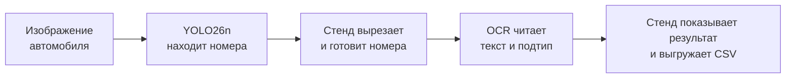

# Распознавание российских ГРЗ

**russian-license-plate-anpr** содержит детектор и OCR для государственных регистрационных знаков РФ (ГРЗ, дальше номера) по ГОСТ Р 50577-2018. Проект поддерживает и нестандартные подтипы номеров.

YOLO26n находит номера на изображении. OCR, то есть модель распознавания текста, читает текст номера и определяет его подтип. В первую очередь проект рассчитан на обычные номера `type1`, двухстрочные `type1a` и жёлтые `type1b`. Результат можно проверить на веб-стенде.

## Быстрый старт: запустить стенд

Для стенда нужны Python 3.11+ (проверено на 3.14) и два файла весов: `checkpoints/plate_detector.pt` и `checkpoints/plate_recognizer.pt`. Оба файла лежат в проекте.

Выполните команды **из корня проекта в PowerShell**:

```powershell
python -m venv .venv
.\.venv\Scripts\Activate.ps1
python -m pip install -r generator/requirements.txt
python -m pip install torch==2.14.0 --index-url https://download.pytorch.org/whl/cu126
python -m pip install ultralytics==8.4.150 fastapi uvicorn python-multipart tqdm
python full_stand/app.py --port 8080
```

Затем:

1. Дождитесь запуска сервера.
2. Откройте **[http://127.0.0.1:8080](http://127.0.0.1:8080)**.
3. Перетащите изображения в окно стенда.

Стенд покажет найденные номера, их текст, подтип и уверенность распознавания. Результаты можно выгрузить в файл кнопкой CSV.

Если доступна CUDA, стенд автоматически работает на GPU. Иначе стенд работает на CPU. Чтобы запустить стенд на CPU при доступной CUDA, добавьте `--device cpu`. Когда зависимости установлены и веса готовы, стенд работает без интернета.

## Как это работает

Стенд передаёт каждое изображение сначала детектору, затем OCR. Если на изображении несколько номеров, стенд выдаёт результат для каждого номера.



1. **Детектор находит номера.** YOLO26n находит рамки номеров на исходном изображении. У детектора один класс: номер. Текст и подтип номера определяет OCR на следующем этапе.
2. **OCR читает номера.** Стенд вырезает каждый найденный номер с небольшими полями. Так получается кроп, то есть изображение одного номера. Стенд приводит кроп к подходящему размеру с учётом соотношения сторон. OCR на основе трансформера определяет подтип и читает символы по очереди. Для каждой позиции OCR учитывает допустимые буквы и цифры.
3. **Стенд показывает результат.** Стенд рисует рамки на исходном изображении и показывает кропы, текст, подтип и уверенность моделей. Стенд обрабатывает изображения через очередь. Каждый результат появляется, как только он готов.

OCR различает 29 подтипов из каталога ГОСТ и класс `unknown`. Так OCR отдельно определяет обычные, двухстрочные, жёлтые, военные и другие номера. Файл CSV хранит текст номера, полный подтип и уверенность моделей.

## Какие данные используются

**Детектор** обучается на изображениях с размеченными рамками номеров. **OCR** обучается на реальных кропах с разметкой текста и на синтетике. Синтетика: изображения, которые создаёт генератор проекта.

| Задача | Источник | Изображений после отбора |
|---|---|---:|
| Детекция | [AUTO.RIA / Nomeroff Net](https://nomeroff.net.ua/), архив 2026-06-04 | 19 888 |
| Детекция | [Car_plate_detecting_dataset](https://huggingface.co/datasets/AY000554/Car_plate_detecting_dataset) | 24 822 |
| Детекция | [Car plate object detection](https://www.kaggle.com/datasets/andrewteplov/car-plate-object-detetcion) | 482 |
| Детекция | [Number plates, 50% Russian / 50% others](https://www.kaggle.com/datasets/kirillpribludenko/number-plates-50-russain-50-others) | 369 |
| OCR | [AUTO.RIA OCR RU, 2021-09-01](https://web.archive.org/web/20220514070933id_/https://nomeroff.net.ua/datasets/autoriaNumberplateOcrRu-2021-09-01.zip), гражданские номера | 56 611 |
| OCR | [AUTO.RIA OCR RU Military, 2022-03-25](https://web.archive.org/web/20220514075608id_/https://nomeroff.net.ua/datasets/autoriaNumberplateOcrRu-Military-2022-03-25.zip), военные номера | 27 513 |
| OCR | [MADE CV / Car plates OCR](https://www.kaggle.com/datasets/xairete/car-plates-ocr), кропы по полигонам разметки | 26 799 |
| OCR | [Car_plate_OCR_dataset](https://huggingface.co/datasets/AY000554/Car_plate_OCR_dataset), уникальная часть | 4 747 |

## Как сгенерировать данные

Используйте окружение из быстрого старта. Основной режим генератора использует **Blender Cycles на NVIDIA GPU**. Команды ниже по порядку готовят Blender, создают выборку и проверяют её:

```powershell
python -m generator.setup --blender
python -m generator generate outputs/synthetic --count 5000 --seed 42 --backend cycles --device CUDA --profile gost --preview
python -m generator validate outputs/synthetic
```

Чтобы создать небольшую пробную выборку, уменьшите `--count`, например до 32. С `--backend cpu` генератор работает без Blender и GPU. Тогда первую команду можно пропустить.

Генератор создаёт каждое изображение так:

1. Выбирает подтип и текст номера.
2. Строит номер по геометрии из ГОСТ.
3. Моделирует съёмку: меняет ракурс, освещение, загрязнение, блики и смаз.

Вместе с изображением генератор автоматически создаёт разметку: текст, подтип и положение номера. Синтетикой можно дополнить реальные данные примерами редких подтипов и разных условий съёмки.

Синтетика для текущего OCR создана с профилем `gost`. Основные параметры генератора:

- `--count` задаёт число изображений.
- `--seed` задаёт seed.
- `--types` оставляет только нужные подтипы, например `--types type1 type1a type1b`.

Генератор сохраняет в `outputs/synthetic/` изображения, разметку `annotations.jsonl`, конфигурацию и отчёт о генерации. Примеры изображений можно посмотреть в `preview.jpg` или `gallery.html`. Команда обучения OCR принимает этот каталог в `--data`.

## Как обучить модели

Команды ниже рассчитаны на **одну NVIDIA GPU** и окружение из быстрого старта. Перед обучением OCR создайте синтетику командами из раздела выше.

### Детектор

```powershell
yolo detect train model=yolo26n.pt data=real_plates2/yolo_plates_ru2/data.yaml `
    epochs=400 patience=40 imgsz=640 batch=16 device=0 project=outputs name=detector
```

Команда `yolo` автоматически скачивает начальные веса `yolo26n.pt`. Лучшие веса команда сохраняет в `outputs/detector/weights/best.pt`. При повторном запуске имя каталога может получить числовой суффикс.

### OCR

Команда обучает OCR на реальных кропах и синтетике. Для валидации она берёт отдельную реальную выборку:

```powershell
python ocr_model/run_training.py `
    --data real_plates2/ocr_plates_ru/train.tsv outputs/synthetic `
    --val-data real_plates2/ocr_plates_ru/val.tsv `
    --output outputs/ocr --epochs 25 --gpus 0 --batch-size 32 --workers 4
```

Скрипт сохраняет лучшие веса в `outputs/ocr/best.pt`, а последние в `outputs/ocr/last.pt`.

- Чтобы проверить один шаг обучения, добавьте `--dry-run`.
- Если не хватает видеопамяти, уменьшите `--batch-size`.
- Если GPU не поддерживает BF16, добавьте `--amp none`.

Чтобы обучить OCR только на реальных кропах, уберите `outputs/synthetic` из команды. Передавайте `train.tsv` в `--data`, а `val.tsv` в `--val-data`. Так скрипт сохранит готовое разделение на обучающую и валидационную выборки.

Веса `checkpoints/plate_recognizer.pt` из проекта обучены 25 эпох на **2 386 685 изображениях**:

| Данные | Изображений |
|---|---:|
| Реальные кропы из `real_plates2/ocr_plates_ru/train.tsv` | 109 886 |
| Синтетика | 2 276 799 |

Синтетика покрывает все 29 подтипов. Больше всего в ней основных подтипов:

- `type1`: 283 660 изображений
- `type1a`: 313 639 изображений
- `type1b`: 287 707 изображений
- каждый из остальных подтипов: от 52 до 54 тысяч изображений

Валидационная выборка смешанная: 5 784 реальных кропа и 43 413 синтетических изображений. Доля полностью верных ответов на ней равна 0.976. Полностью верный ответ значит, что OCR верно определил и текст, и подтип.

### Проверить свои модели на стенде

```powershell
python full_stand/app.py `
    --detector outputs/detector/weights/best.pt `
    --recognizer outputs/ocr/best.pt --port 8080
```

Откройте тот же адрес [http://127.0.0.1:8080](http://127.0.0.1:8080). Загрузите изображения для проверки.

Чтобы увидеть все параметры команды, запустите её с `--help`.
